# LemonDB

**コンテキスト対応の SQL ワークベンチ：スマート補完・ショートカット・AI・ETL。1 つのクライアントで複数サーバーに同時接続。**

LemonDB は開発者と DBA 向けのデータベースワークベンチです。デスクトップクライアントは SQL エディタ、AI アシスタント、データ同期キャンバス、Redis、BI ダッシュボードを一つのウィンドウにまとめます。各 LemonDB サーバーは接続・権限・タスクを独立して管理します。

[English](./README.md) · [简体中文](./README.zh-CN.md) · [スクリーンショット](./docs/SCREENSHOTS.md) · [更新履歴](./CHANGELOG.md)

## プロジェクト状態と検証範囲

**本プロジェクトは開発・プレビュー段階であり、全面的な検証はまだ完了していません。現在は MySQL 系データベースのコア利用フローの検証に重点を置いています。これは、すべての MySQL 互換製品・バージョン・機能が検証済みであることを意味しません。**

他のデータベースアダプタ、および AI アシスタント、AI スキーマドキュメント、ビジュアルクエリと関係キャンバス、移行・バックアップ、ETL、Redis、SQL ワークオーダー、BI ダッシュボードなどの拡張機能は、現時点では**実験機能**として提供され、引き続き改善中です。機能エントリとデモ画面は現状の実装を示すものであり、本番利用可能または完全互換を保証するものではありません。本番利用前に、実際のデータベースバージョン、権限設定、運用フローで検証してください。

## デモとダウンロード

- オンラインデモ：[http://test.ychos.cn:7777/](http://test.ychos.cn:7777/)
- 完全デプロイパッケージ：[release.zip をダウンロード](./release.zip)（JAR、SQL 初期化ファイル、`bin` ディレクトリを含む）

## 製品の特徴

### 1. コンテキスト対応 SQL 補完

キャレット位置に応じて表名・カラム・キーワードを出し分けます。候補を無差別に並べるだけではありません：

- `FROM` / `JOIN` の後は表を優先。カンマで続けて結合する場合も表を提案
- 比較演算子の右側ではカラムを提案。エイリアス未指定時は、当該文の `FROM` / `JOIN` にある全表のカラムを集約
- `エイリアス.` 入力時はドット以降だけを置換
- 複数文スクリプトではキャレットのある文だけを解析。未閉じのバッククォート等はスマートに閉じる
- 方言に応じたキーワード・関数補完

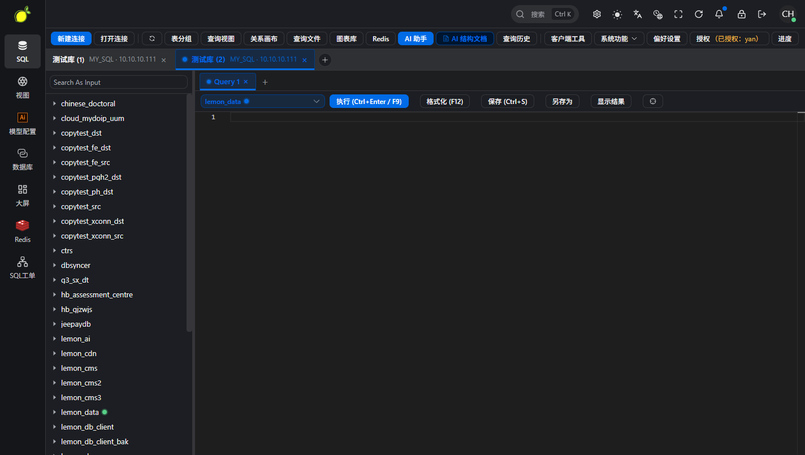

### 2. クエリショートカット

ショートカットはクエリタブ単位でバインドされ、keep-alive 再利用時の取り違えを防ぎます：

| ショートカット | 動作 |
| --- | --- |
| `F9` または `Ctrl/Cmd + Enter` | 現在のクエリを実行 |
| `Ctrl/Cmd + S` | クエリを保存（現在の接続・データベースに紐付け） |
| `F12` | SQL を整形 |
| `Ctrl/Cmd + Shift + E` | Explain（埋め込みモード以外） |
| `Ctrl/Cmd + K` | Ask AI を起動 |
| `Ctrl/Cmd + ,` | サーバーセレクタを開く |

### 3. AI アシスタントとスキーマドキュメント

現在の接続とスキーマを踏まえて SQL の生成・説明・最適化、エラー分析、チャート補助を行います。スキーマドキュメントは全量／増分生成と変更検出に対応（**実験機能**）。

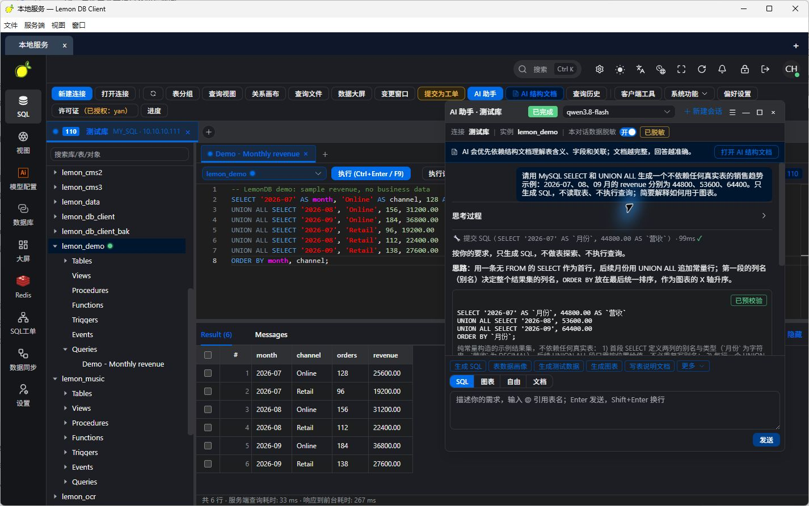

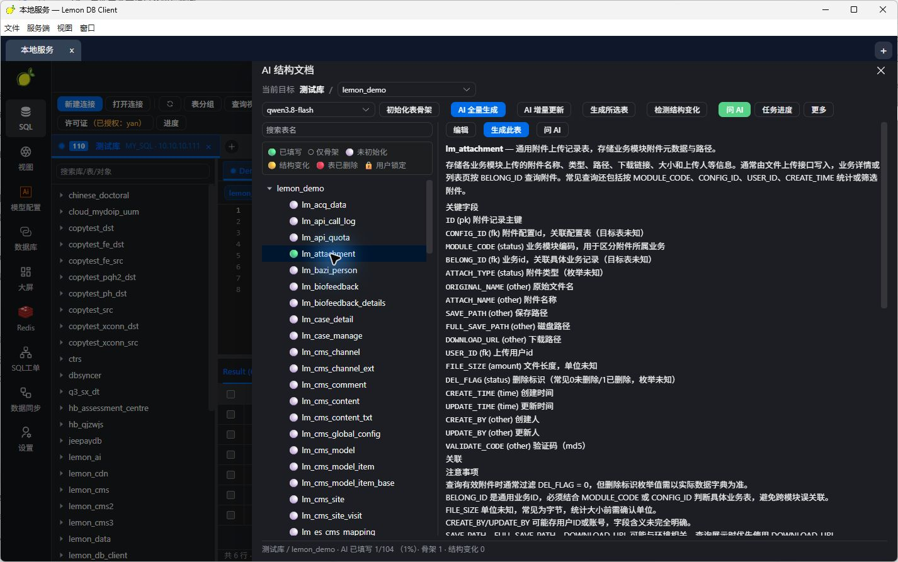

### 4. ETL データ同期キャンバス

キャンバス上で複数タスクのパイプラインを編成：フィールドマッピング、読み取り専用プレビュー、スケジュール、協調同期の入口（**実験機能**）。ノードをドラッグして配置でき、右クリックで名前変更・削除などの操作が可能です。

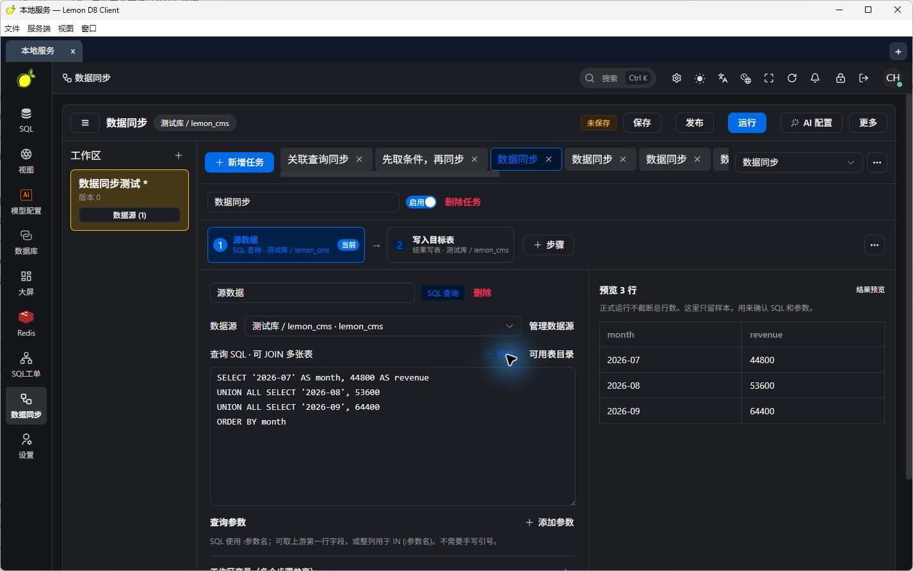

### 5. 複数サーバーを一つのウィンドウで

開発・テスト・本番にそれぞれ LemonDB サーバーをデプロイし、クライアント上部タブで同時に開けます：

- **同時オンライン**：タブ切替でも他サーバーは切断されない
- **独立セッション**：ログイン、接続、SQL タブ、バックグラウンドタスク、AI モデル選択は相互干渉しない
- **ローカル設定**：よく使う API ルート（context-path 含む、例 `http://localhost:7806/lmdb`）を保存

```text
LemonDB デスクトップクライアント
├── 開発サーバータブ → 開発 MySQL / PostgreSQL / Redis
├── テストサーバータブ → テスト DB / データ同期タスク
└── 本番サーバータブ → 独立ログイン / 権限 / SQL ワークオーダー
```

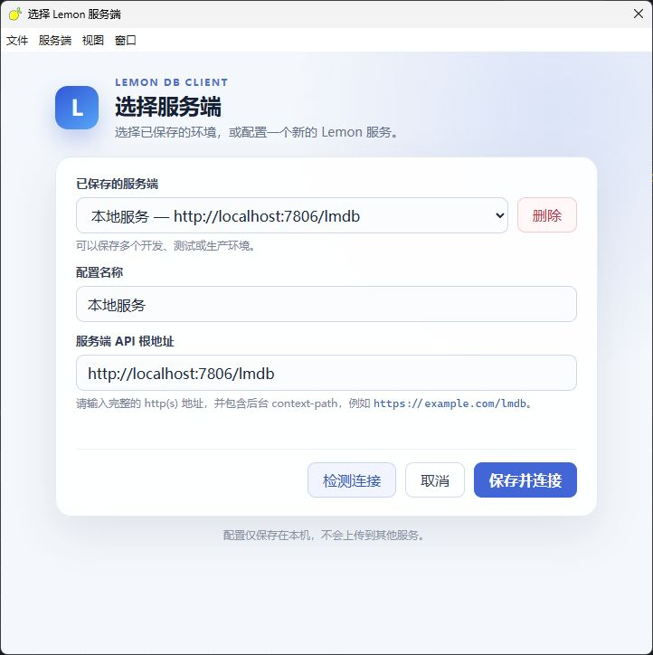

## 想定ユースケース

本番 DB に個人 PC から直接接続できない環境や、社内でデータベースアクセス権限を一元管理したい場面向けです。ターゲット DB に届く場所へサーバーを配置し、ユーザーはブラウザまたはデスクトップクライアントから接続します。企業は接続を集中管理し、接続／DB／表単位で権限を付与し、SQL ワークオーダーで提出・レビュー・実行を整理できます。

## 主な機能

| 機能 | できること |
| --- | --- |
| SQL ワークベンチ | コンテキスト補完、実行／保存／整形／Explain のショートカット、複数クエリタブ、結果の閲覧・編集、履歴 |
| DB 配下の保存クエリ | 接続と DB ごとに名前付きクエリを保存し、オブジェクトツリーから再開。SQL ファイルのインポート可 |
| AI アシスタント／スキーマドキュメント | SQL の生成・説明・最適化、エラー分析、チャート補助。全量／増分ドキュメントと変更検出（実験） |
| データ同期（ETL） | キャンバス複数タスク、フィールドマッピング、読み取り専用プレビュー、スケジュール、Kettle 取り込み入口（実験） |
| 複数サーバターブ | 一つのウィンドウで複数環境。独立セッションとローカル設定 |
| データベース接続 | 現在は MySQL 系の検証に重点。PostgreSQL、Oracle、SQL Server、達夢、H2、SQLite、MongoDB などは実験アダプタ |
| ビジュアルクエリと関係キャンバス | キャンバスでクエリを整理し、表関係を確認（実験） |
| 移行とバックアップ | 接続間コピー、SQL 入出力、バックアップとネイティブ取り込み。バックグラウンドで進捗表示 |
| Redis コンソール | キー／型／TTL、編集、CLI モード（実験） |
| SQL ワークオーダーと権限 | 提出・レビュー・実行。接続／DB／表の ACL（実験） |
| BI ダッシュボード | SQL をチャートにバインドして公開（実験） |

検証範囲は本ページ「プロジェクト状態と検証範囲」に従います。実際に使える操作は方言・ドライバ・アカウント権限に依存します。OceanBase、PolarDB、KingbaseES、GaussDB/openGauss などの互換アダプタも製品・バージョンごとの確認が必要です。

## ワークベンチギャラリー

2026-10-12 撮影の中国語 UI 画面に加え、開発マシン上で稼働中の Lemon DB Client のライブキャプチャを掲載しています。クエリとチャートはデモデータです。英語版は[スクリーンショット説明](./docs/SCREENSHOTS.md)を参照してください。

### デスクトップクライアント（ライブ）

ローカルで稼働中の Lemon DB Client（ウィンドウタイトル例：`测试服务 — Lemon DB Client`、中国語 UI）：

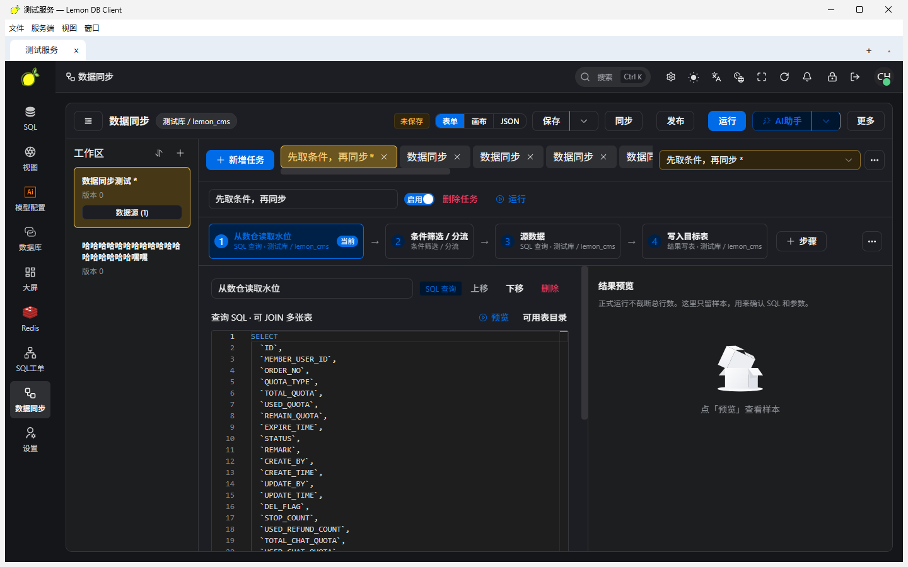

### SQL 編集と結果

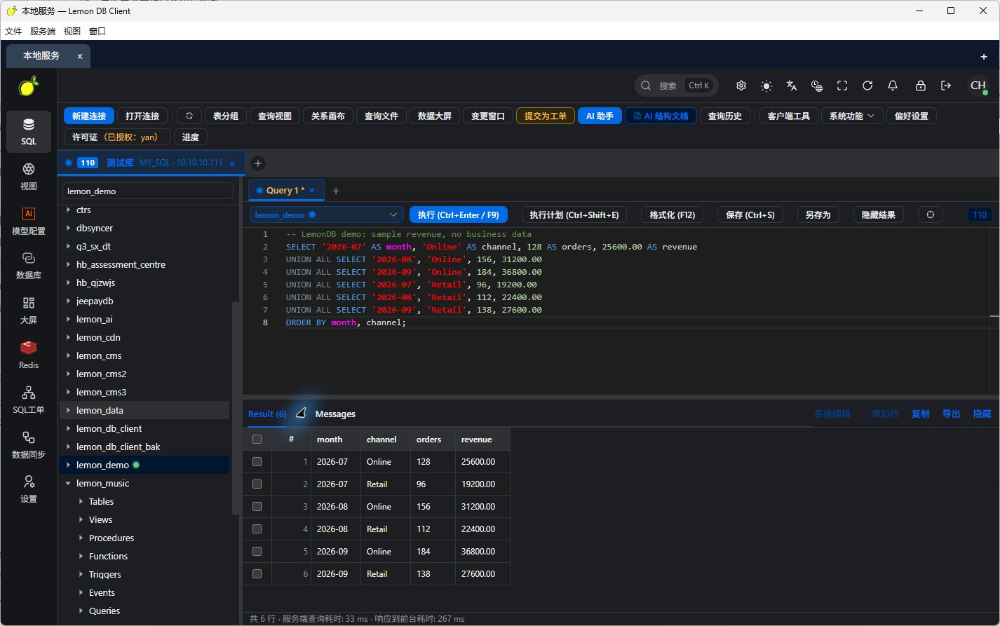

### データベース配下の保存クエリ

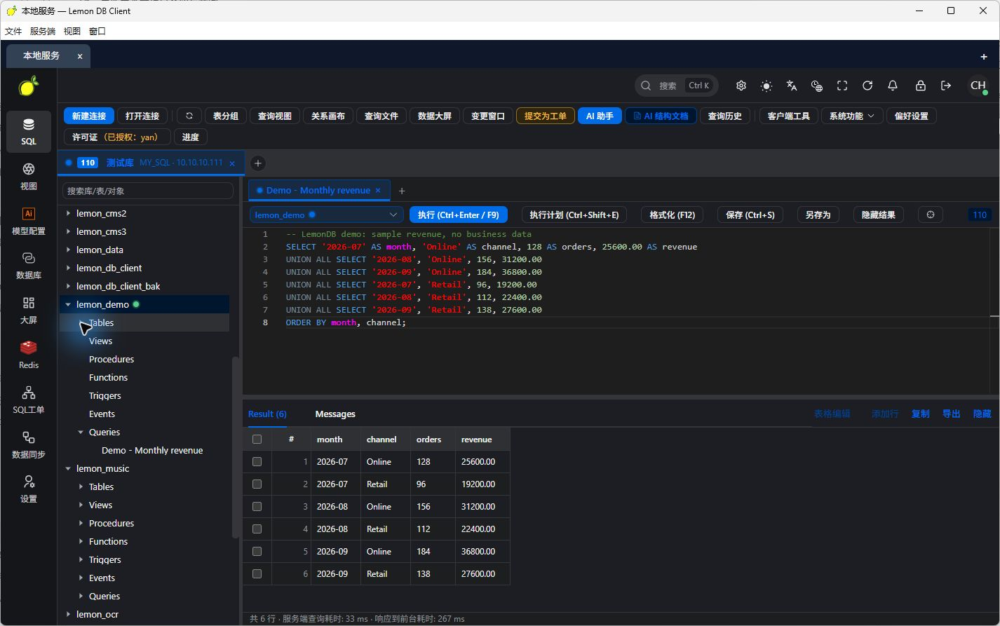

### Redis と BI ダッシュボード

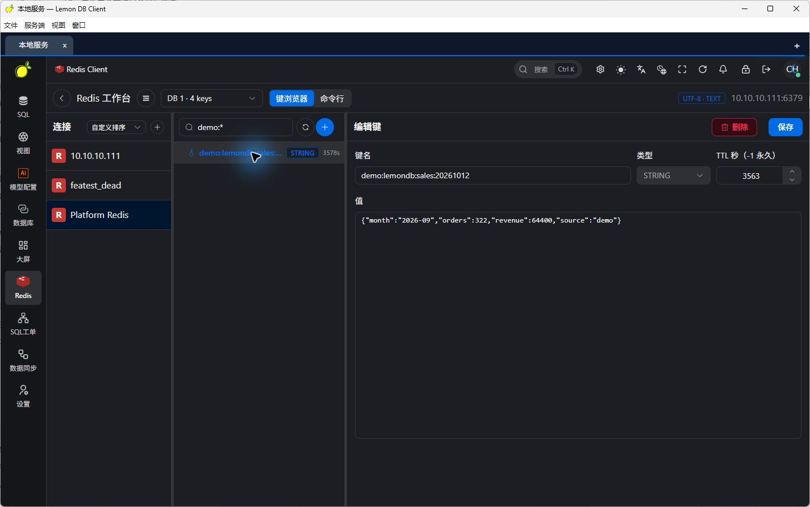

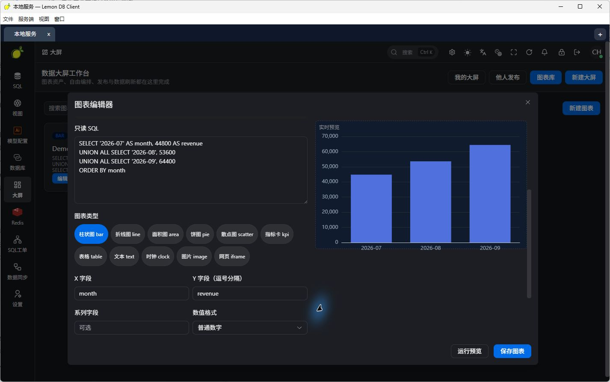

### SQL ワークオーダー

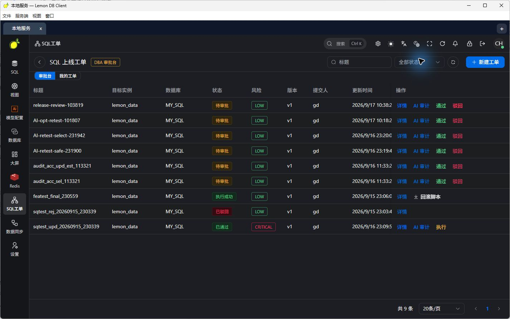

## はじめに

### デスクトップクライアント

1. OS に対応する Lemon DB Client のリリースパッケージをインストールします。
2. サーバー名と API ベース URL（例：`http://localhost:7806/lmdb`）を入力します。
3. 接続テスト後に保存して接続し、そのサーバーのアカウントでログインします。
4. 上部の `+` で別サーバーを追加し、タブを切り替えます。

Electron ベースで Windows / macOS / Linux のパッケージ設定があります。実際のインストーラはリリース資産を確認してください。デプロイ済みの Web ワークベンチをブラウザで開くこともできます。

### サーバー：JAR を起動するだけ

フロントエンドは JAR に同梱済みです。デプロイパッケージを展開し、同梱 SQL で初期化し、環境を設定してから：

```bash
java -jar lemon-main.jar --spring.profiles.active=pro
```

ブラウザで [http://127.0.0.1:7806/lmdb/view/index.html](http://127.0.0.1:7806/lmdb/view/index.html) を開きます。デスクトップクライアントの API ベース URL は `http://127.0.0.1:7806/lmdb` です。

バックエンドは Java 8、Spring Boot、MySQL、Redis です。ソースからビルドする場合：

```bash
mvn clean package -DskipTests
java -jar lemon-main/target/lemon-main.jar --spring.profiles.active=pro
```

起動前にメタデータ用データソースと Redis を設定してください。デフォルト API ベース URL は `http://localhost:7806/lmdb`。ターゲット DB はそのサーバーから到達可能である必要があります。

## アーキテクチャ

```text
デスクトップクライアント（Electron / Vue）または Web ワークベンチ
    → API リクエスト
LemonDB サーバー（Spring Boot）
    ├── DB 接続 / SQL 補完・実行 / 保存クエリ
    ├── AI アシスタント / スキーマドキュメント
    ├── Redis / ETL キャンバス / BI ダッシュボード
    ├── 権限 / SQL ワークオーダー / バックグラウンドタスク
    └── DB ドライバと方言 → ターゲットデータベース
```

**作者：yanch**

ライセンスは公開リポジトリの LICENSE に従ってください。本展示用ディレクトリには現時点で LICENSE ファイルは含まれていません。