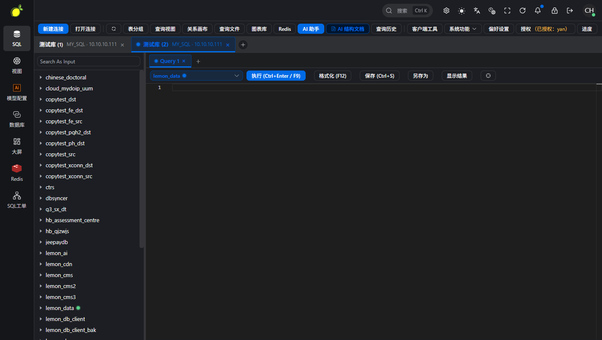
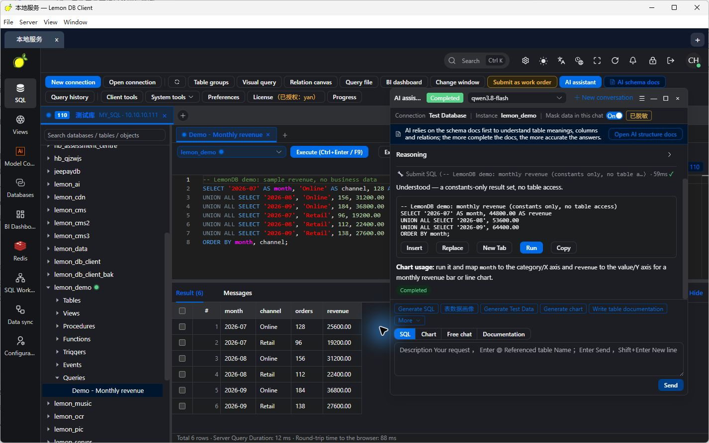
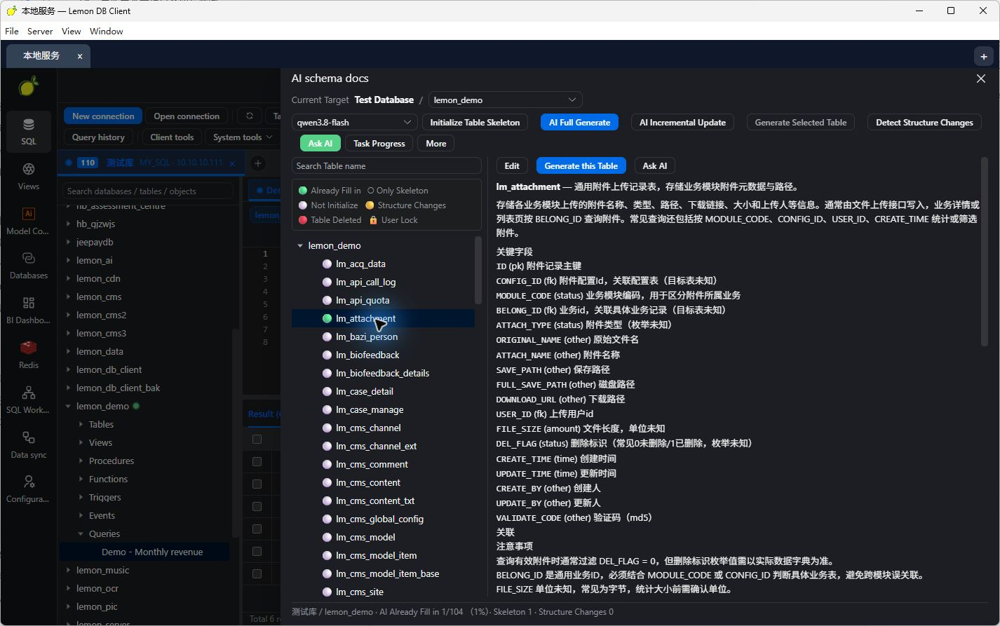
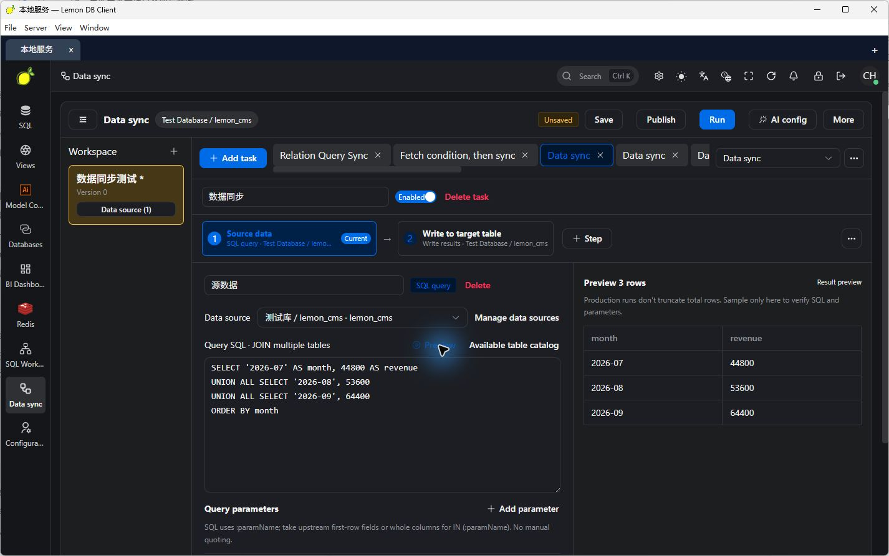
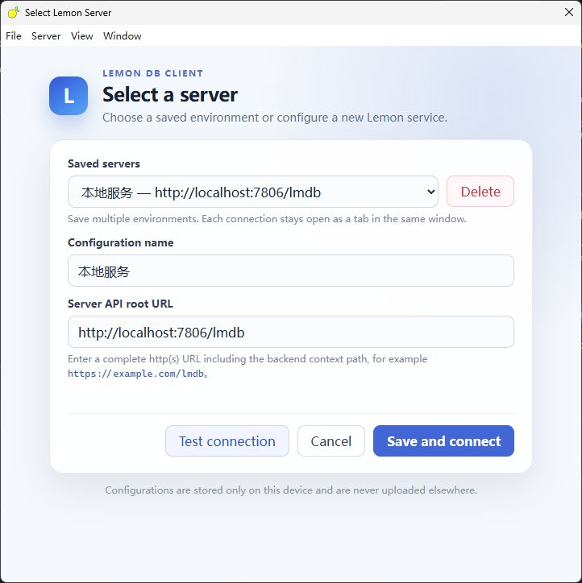
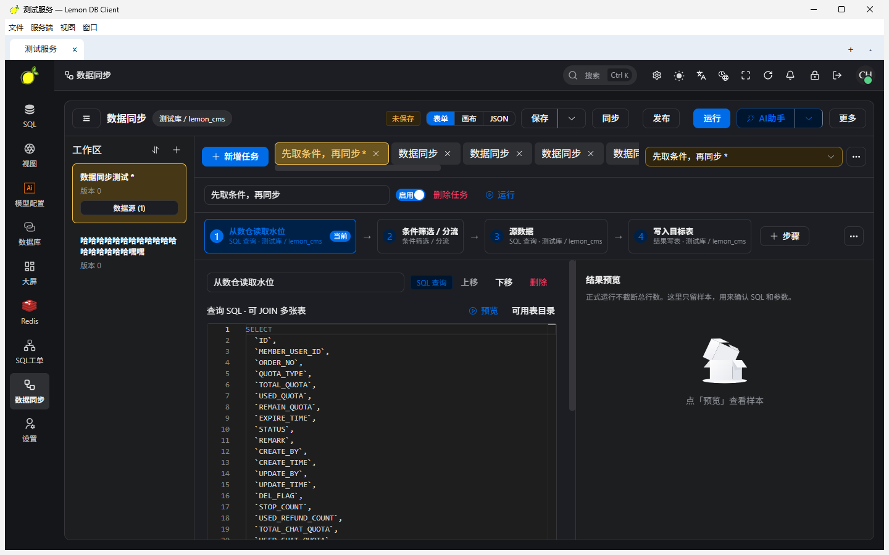
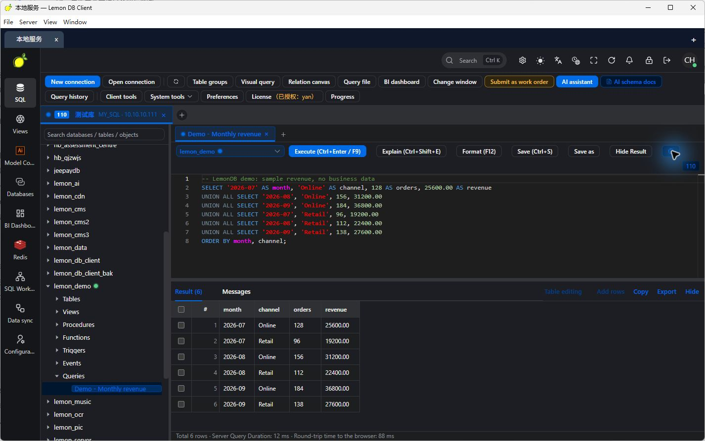
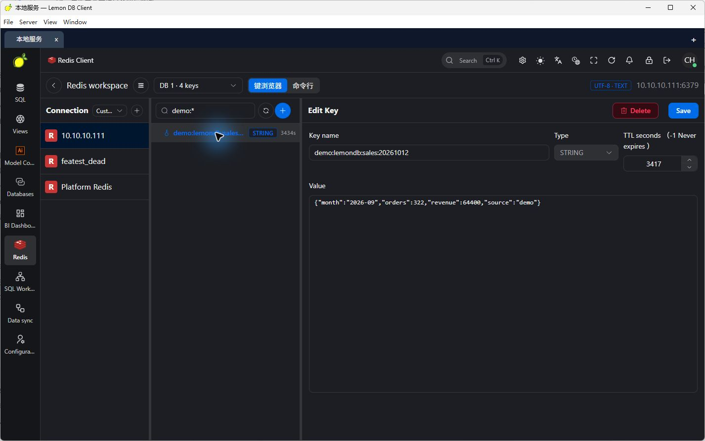
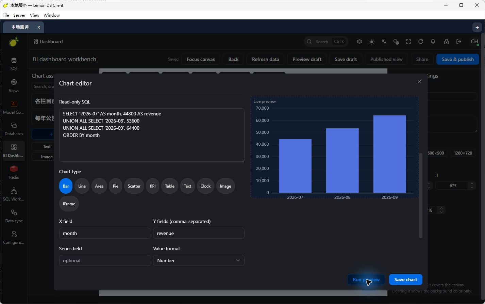
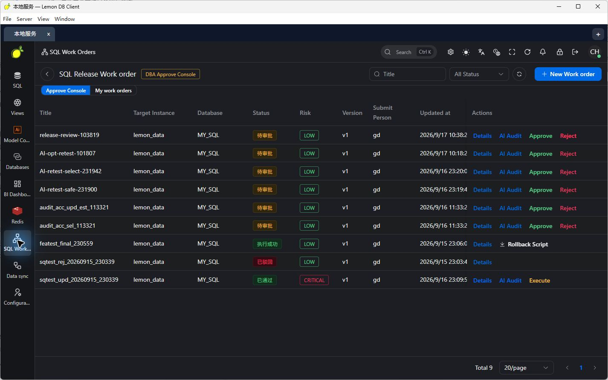

# LemonDB

**A context-aware SQL workbench: smart completion, shortcuts, AI, and ETL—one client connected to multiple servers at once.**

LemonDB is built for developers and DBAs. The desktop client brings a SQL editor, AI assistant, data-pipeline canvas, Redis console, and BI dashboards into one window. Each LemonDB server manages its own connections, permissions, and tasks.

[简体中文](./README.zh-CN.md) · [日本語](./README.ja-JP.md) · [Screenshot notes](./docs/SCREENSHOTS.md) · [Changelog](./CHANGELOG.md)

## Project status and validation scope

**LemonDB is under active development and available as a preview. Validation currently focuses on core workflows for MySQL-family databases. This does not mean that every MySQL-compatible product, version, or feature has been validated.**

Other database adapters and extended capabilities—including the AI assistant, AI schema documentation, visual queries and relation canvas, migration and backup, ETL, Redis, SQL work orders, and BI dashboards—are currently **experimental** and still being refined. Feature entries and demonstration screenshots show the current implementation; they do not establish production readiness or full compatibility. Before production use, validate your database version, permission configuration, and operational workflows.

## Demo and download

- Online demo: [http://test.ychos.cn:7777/](http://test.ychos.cn:7777/)
- Complete deployment package: [Download release.zip](./release.zip), containing the JAR, SQL initialization files, and a `bin` directory.

## Product highlights

### 1. Context-aware SQL completion

Completion inspects the caret context so candidates are tables, columns, or keywords—not an undifferentiated dump:

- Prefer tables after `FROM` / `JOIN`; keep suggesting tables after a comma in a join list
- Suggest columns on the right-hand side of comparisons; without an alias prefix, gather columns from every table in the current statement’s `FROM` / `JOIN`
- After `alias.`, replace only the part after the dot
- Multi-statement scripts analyze only the statement under the caret; unclosed backticks and similar quotes are closed intelligently
- Dialect-aware keywords and functions



### 2. Query shortcuts

Shortcuts are bound per query tab so keep-alive reuse does not cross-wire actions:

| Shortcut | Action |
| --- | --- |
| `F9` or `Ctrl/Cmd + Enter` | Run the current query |
| `Ctrl/Cmd + S` | Save the query (scoped to the current connection and database) |
| `F12` | Format SQL |
| `Ctrl/Cmd + Shift + E` | Explain (non-embedded mode) |
| `Ctrl/Cmd + K` | Open Ask AI |
| `Ctrl/Cmd + ,` | Open the server selector |

### 3. AI assistant and schema documentation

Generate, explain, and optimize SQL using the active connection and schema; investigate errors and draft charts. Schema docs support full / incremental generation and change detection (**experimental**).





### 4. ETL data-pipeline canvas

Orchestrate multi-task pipelines on a canvas: field mapping, read-only result previews, schedules, and collaboration entry points (**experimental**). Drag nodes to arrange the flow; common actions such as rename and delete are available from the context menu.



### 5. Multiple servers in one window

Deploy separate LemonDB servers for development, testing, and production, and keep them open as tabs:

- **Stay connected:** switching tabs does not drop other servers
- **Separate sessions:** login, connections, SQL tabs, background tasks, and AI model choices stay isolated
- **Local profiles:** save API base URLs (including context-path, e.g. `http://localhost:7806/lmdb`)

```text
LemonDB desktop client
├── Development server tab → Dev MySQL / PostgreSQL / Redis
├── Test server tab        → Test databases / Data pipelines
└── Production server tab  → Separate login / Permissions / SQL work orders
```



## Intended use cases

LemonDB fits production environments where users cannot reach databases directly from their PCs, and enterprises that need centrally managed access. Deploy the server where it can reach target databases; users connect through a browser or the desktop client. Enterprises can manage connections, assign permissions at connection / database / table levels, and use SQL work orders for submit → review → execute.

## Main capabilities

| Capability | What you can do |
| --- | --- |
| SQL workbench | Context-aware completion; shortcuts for run / save / format / Explain; query tabs; result browse and edit; history |
| Queries under databases | Save named queries per connection and database; reopen from the object tree; import SQL files |
| AI assistant / schema docs | Generate, explain, optimize SQL; analyze errors; chart help; full/incremental docs and change detection (experimental) |
| Data pipelines (ETL) | Canvas multi-task flows, field mapping, read-only preview, schedules, Kettle import entry (experimental) |
| Multi-server tabs | Several environments in one window with isolated sessions and local profiles |
| Database connections | Validation focuses on MySQL-family; PostgreSQL, Oracle, SQL Server, Dameng, H2, SQLite, MongoDB, and others are experimental adapters |
| Visual queries and relation canvas | Organize queries visually and explore relationships (experimental) |
| Migration and backup | Cross-connection copy, SQL import/export, backup and native import with background progress |
| Redis console | Keys / types / TTL, edit values, CLI mode (experimental) |
| SQL work orders and permissions | Submit, review, execute; connection / database / table ACL (experimental) |
| BI dashboards | Bind SQL to charts and publish views (experimental) |

Validation follows “Project status and validation scope.” Available operations depend on dialect, drivers, and account permissions. OceanBase, PolarDB, KingbaseES, and GaussDB/openGauss adapters also need version-specific checks.

## Workbench gallery

English UI captures from 2026-10-12, plus a live Lemon DB Client window shot from the developer machine. Queries and charts use demonstration data. Matching Chinese images: [screenshot notes](./docs/SCREENSHOTS.md).

### Live desktop client

Running Lemon DB Client on the local machine (window title example: `测试服务 — Lemon DB Client`; Chinese UI):



### SQL editor and results


### Queries belong to their database



### Redis and BI dashboards





### SQL work orders



## Getting started

### Desktop client

1. Install the Lemon DB Client release package for your OS.
2. Enter a server name and API base URL, such as `http://localhost:7806/lmdb`.
3. Test the connection, save and connect, then sign in with an account on that server.
4. Click `+` to connect another server and switch between tabs.

The Electron app has packaging for Windows, macOS, and Linux; check release assets for what is actually published. You can also open a deployed Web workbench in a browser.

### Server: start the JAR

The frontend is bundled in the JAR. Extract the deployment package, initialize with the included SQL, configure the environment, and run:

```bash
java -jar lemon-main.jar --spring.profiles.active=pro
```

Open [http://127.0.0.1:7806/lmdb/view/index.html](http://127.0.0.1:7806/lmdb/view/index.html). The desktop client API base URL is `http://127.0.0.1:7806/lmdb`.

Backend stack: Java 8, Spring Boot, MySQL, Redis. Build from source:

```bash
mvn clean package -DskipTests
java -jar lemon-main/target/lemon-main.jar --spring.profiles.active=pro
```

Configure the metadata datasource and Redis before start. Default API base URL: `http://localhost:7806/lmdb`. Target databases must be reachable from the server.

## Architecture

```text
Desktop client (Electron / Vue) or Web workbench
    → API requests
LemonDB server (Spring Boot)
    ├── Database connections / SQL completion & execution / Saved queries
    ├── AI assistant / Schema documentation
    ├── Redis / ETL canvas / BI dashboards
    ├── Permissions / SQL work orders / Background tasks
    └── Database drivers and dialects → Target databases
```

**Author: yanch**

Refer to the LICENSE file in the published repository for licensing terms. This presentation directory does not currently contain a LICENSE file.