# LemonDB · 柠檬数据库客户端

**上下文感知的 SQL 工作台：智能补全、快捷键、AI 与 ETL，一个客户端同时连接多个服务端。**

LemonDB 面向开发者与 DBA。桌面客户端把 SQL 编辑器、AI 助手、数据同步画布、Redis 与数据大屏收进同一窗口；每个 LemonDB 服务端独立管理连接、权限与任务。

[English](./README.md) · [日本語](./README.ja-JP.md) · [截图说明](./docs/SCREENSHOTS.md) · [更新记录](./CHANGELOG.md)

## 项目状态与验证范围

**项目目前处于开发与预览阶段，尚未完成全面验证。当前着重验证 MySQL 族数据库的核心使用流程；这不代表所有 MySQL 兼容产品、版本和功能均已验证。**

其他数据库适配，以及 AI 助手、AI 结构文档、可视化查询与关系画布、数据迁移与备份、ETL、Redis、SQL 工单和数据大屏等扩展功能，目前作为**实验功能**提供，仍在完善中。功能入口和演示截图展示当前实现，不代表已经达到生产可用或完整兼容的状态。用于生产环境前，请针对实际数据库版本、权限配置和操作流程进行验证。

## 演示与下载

- 在线演示：[http://test.ychos.cn:7777/](http://test.ychos.cn:7777/)
- 完整部署包：[下载 release.zip](./release.zip)，包含 JAR 包、SQL 初始化文件和 `bin` 目录。

## 产品特色

### 1. SQL 上下文感知补全

补全会按光标所在位置判断该提示表名、字段还是关键字，而不是整表灌进候选列表：

- `FROM` / `JOIN` 之后优先补表；逗号继续联表时仍补表
- 比较运算符右侧可补字段；未写别名时汇总当前语句 `FROM` / `JOIN` 中全部表的字段
- 输入 `别名.` 时只替换点号后面的字段部分
- 多语句脚本只分析光标所在的当前语句；未闭合的反引号等引号会智能补闭合
- 按方言提供关键字与函数补全

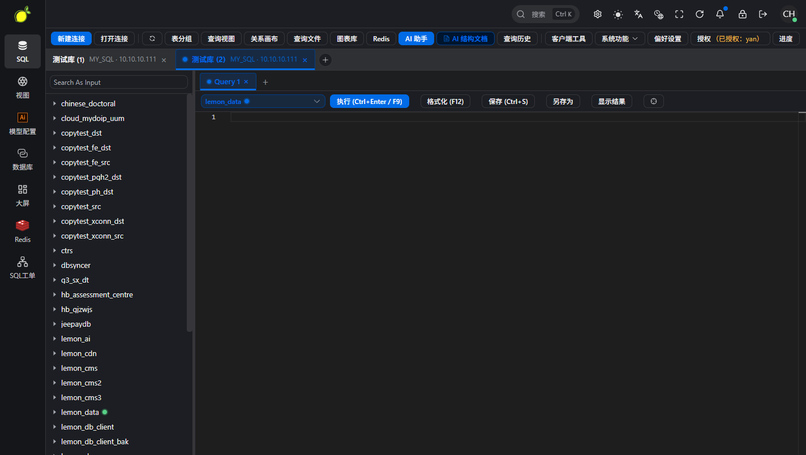

### 2. 查询快捷键

快捷键绑定在查询页签级，避免 keep-alive 下串台：

| 快捷键 | 作用 |
| --- | --- |
| `F9` 或 `Ctrl/Cmd + Enter` | 执行当前查询 |
| `Ctrl/Cmd + S` | 保存查询（归属当前连接与数据库） |
| `F12` | 格式化 SQL |
| `Ctrl/Cmd + Shift + E` | Explain（非嵌入模式） |
| `Ctrl/Cmd + K` | 唤起 Ask AI |
| `Ctrl/Cmd + ,` | 打开服务端选择器 |

### 3. AI 助手与结构文档

在当前连接与库结构上下文中生成、解释、优化 SQL，分析报错并辅助图表；结构文档支持全量 / 增量生成与变更检测（实验功能）。

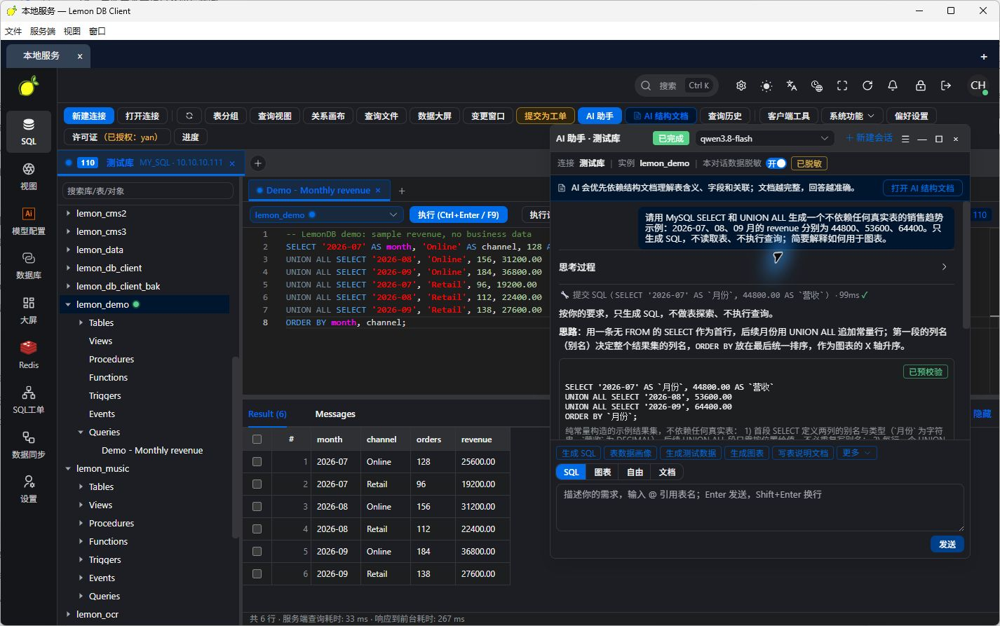

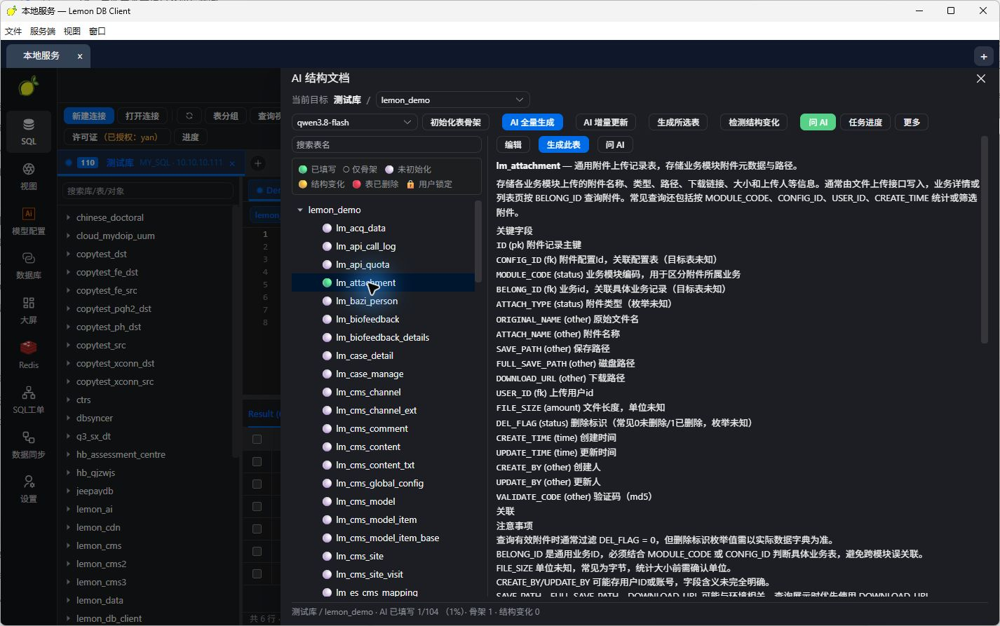

### 4. ETL 数据同步画布

用画布编排多任务流水线：字段映射、只读结果预览、定时任务与协作同步入口（实验功能）。节点可在画布上拖拽编排，并支持右键重命名、删除等常用操作。

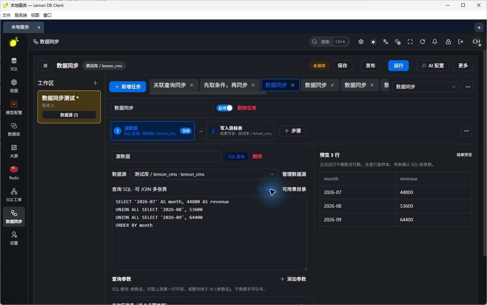

### 5. 多服务端同窗

开发、测试与生产可分别部署 LemonDB 服务端，客户端用顶部标签同时打开：

- **同时在线**：切换标签不断开其他服务端
- **独立会话**：登录、连接、SQL 标签、后台任务与 AI 模型选择互不干扰
- **本地配置**：保存常用 API 根地址（含 context-path，例如 `http://localhost:7806/lmdb`）

```text
LemonDB 桌面客户端
├── 开发服务端标签 → 开发 MySQL / PostgreSQL / Redis
├── 测试服务端标签 → 测试数据库 / 数据同步任务
└── 生产服务端标签 → 独立登录 / 权限 / SQL 工单
```

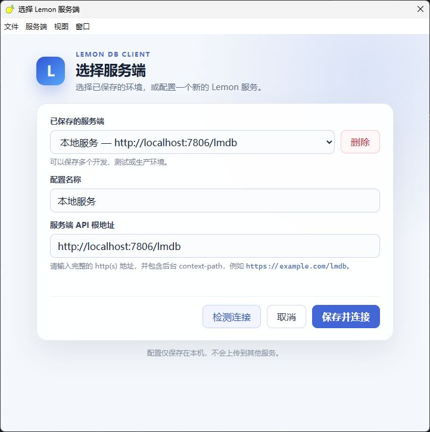

## 适用场景

面向生产库无法从个人电脑直连，以及企业内部需要统一管理数据库访问权限的场景。将服务端部署在能访问目标库的环境，用户通过浏览器或桌面客户端接入；企业可集中管理连接，按连接 / 库 / 表授权，并用 SQL 工单组织提交、审核与执行。

## 主要功能

| 功能 | 能做什么 |
| --- | --- |
| SQL 工作台 | 上下文补全、快捷键执行/保存/格式化/Explain、多查询标签、结果查看与编辑、查询历史 |
| 库下保存 SQL | 按连接和数据库保存命名查询，对象树重开；支持导入 SQL 文件 |
| AI 助手 / 结构文档 | 生成解释优化 SQL、分析报错、图表辅助；全量/增量文档与变更检测（实验） |
| 数据同步（ETL） | 画布多任务、字段映射、只读预览、定时任务、Kettle 导入入口（实验） |
| 多服务端标签 | 一窗多环境，独立会话与本地配置 |
| 数据库连接 | 当前着重验证 MySQL 族；PostgreSQL、Oracle、SQL Server、达梦、H2、SQLite、MongoDB 等为实验适配 |
| 可视化查询与关系画布 | 画布组织查询，查看表关系（实验） |
| 数据迁移与备份 | 跨连接复制、SQL 导入导出、备份与原生导入，后台任务展示进度 |
| Redis 控制台 | 键 / 类型 / TTL、编辑与命令行（实验） |
| SQL 工单与授权 | 提交审核执行；按连接、库、表授权（实验） |
| 数据大屏 | SQL 绑定图表并发布展示页（实验） |

验证范围以本页「项目状态与验证范围」为准。具体能力取决于方言、驱动与账号权限；OceanBase、PolarDB、KingbaseES、GaussDB/openGauss 等兼容库需按版本自测。

## 工作台展示

以下含 2026-10-12 中文界面截图，以及本机 Lemon DB Client 实拍窗口。查询与图表使用示例数据。英文对应图见[截图说明](./docs/SCREENSHOTS.md)。

### 桌面客户端实拍

本机正在运行的 Lemon DB Client（窗口标题示例：`测试服务 — Lemon DB Client`）：

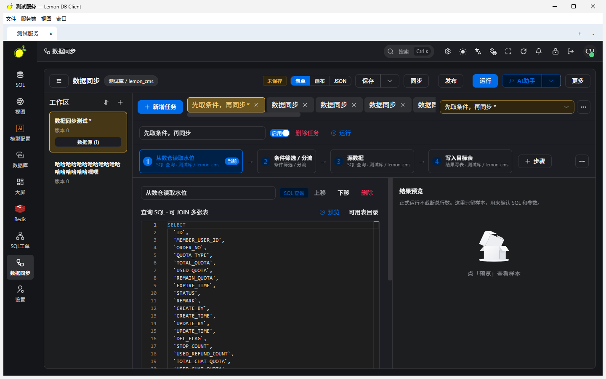

### SQL 编辑与结果

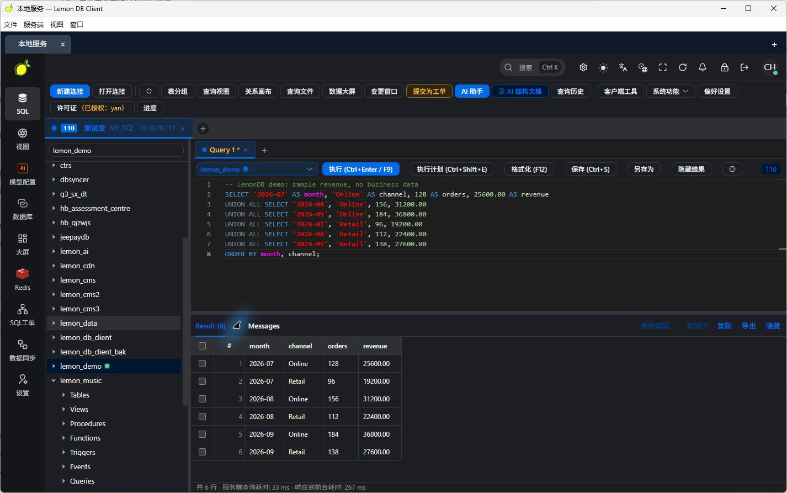

### SQL 保存到所属数据库

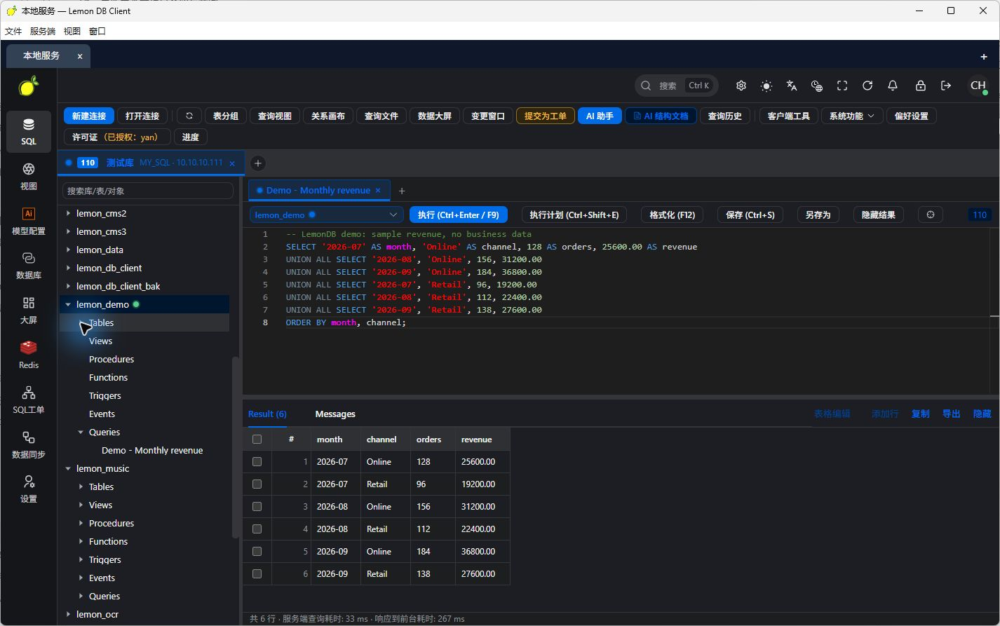

### Redis 与数据大屏

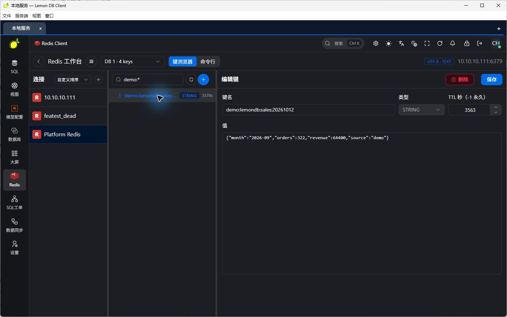

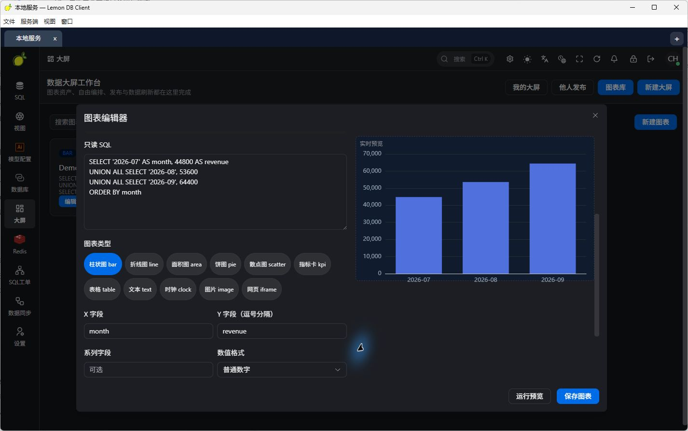

### SQL 工单

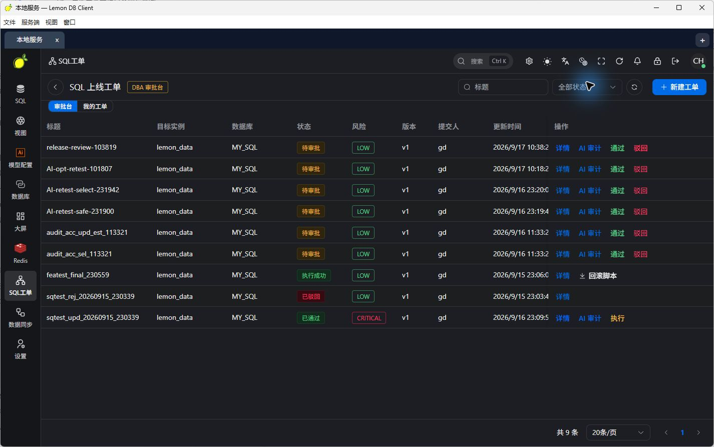

## 开始使用

### 桌面客户端

1. 安装与操作系统对应的 Lemon DB Client 发布包。
2. 打开客户端，输入服务端名称和 API 根地址，例如 `http://localhost:7806/lmdb`。
3. 检测连接，保存并连接，然后使用该服务端账号登录。
4. 点击顶部 `+` 接入其他服务端，在标签之间切换。

桌面端基于 Electron；Windows、macOS 与 Linux 均有打包配置，实际安装包以发布资产为准。也可直接访问已部署的 Web 工作台。

### 服务端：启动 JAR 即可使用

前端已打入 JAR，无需单独部署前端。解压部署包，用包内 SQL 初始化并配置环境后启动：

```bash
java -jar lemon-main.jar --spring.profiles.active=pro
```

浏览器访问 [http://127.0.0.1:7806/lmdb/view/index.html](http://127.0.0.1:7806/lmdb/view/index.html)。桌面客户端 API 根地址填 `http://127.0.0.1:7806/lmdb`。

当前后端使用 Java 8、Spring Boot、MySQL 与 Redis。源码构建：

```bash
mvn clean package -DskipTests
java -jar lemon-main/target/lemon-main.jar --spring.profiles.active=pro
```

启动前配置元数据数据源与 Redis。默认 API 根地址为 `http://localhost:7806/lmdb`；目标库须能被该服务端访问。

## 架构

```text
桌面客户端（Electron / Vue）或 Web 工作台
    → API 请求
LemonDB 服务端（Spring Boot）
    ├── 数据库连接 / SQL 补全与执行 / 查询保存
    ├── AI 助手 / 结构文档
    ├── Redis / ETL 画布 / 数据大屏
    ├── 权限 / SQL 工单 / 后台任务
    └── 数据库驱动与方言 → 目标数据库
```

**作者：yanch**

许可证以正式发布仓库的 LICENSE 文件为准；当前展示目录尚未包含 LICENSE 文件。