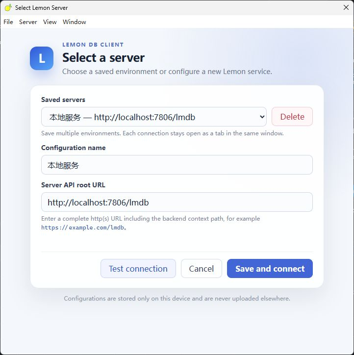
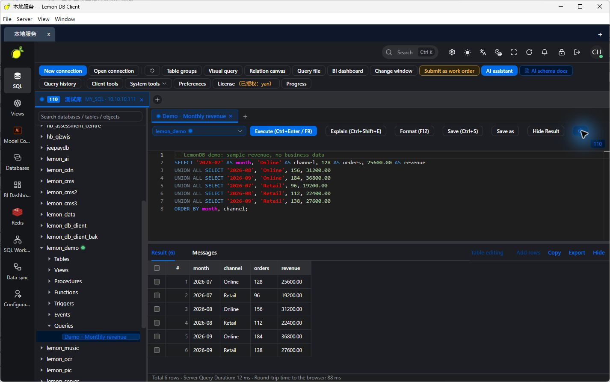
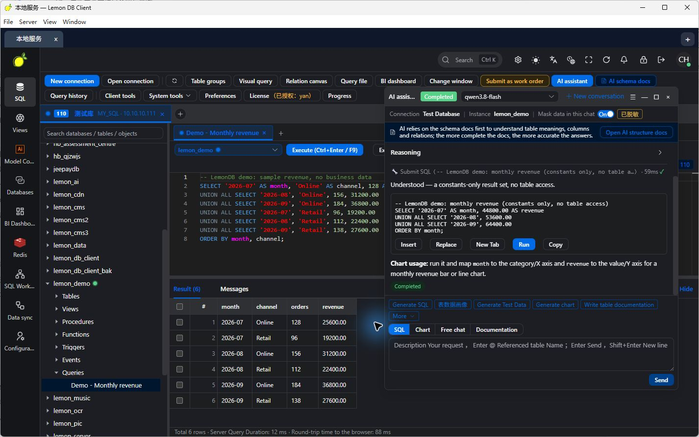
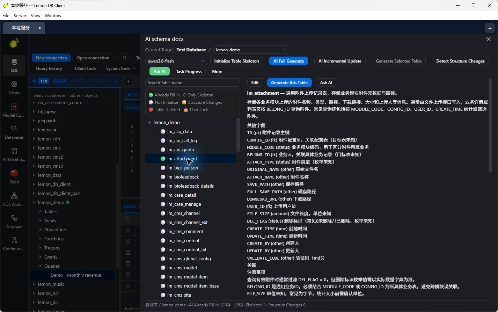
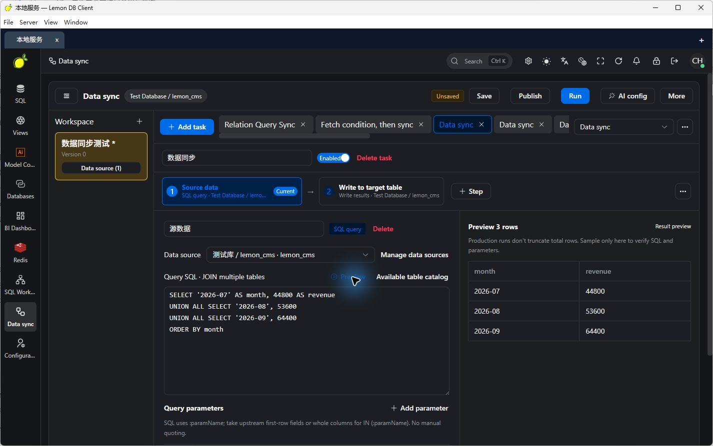
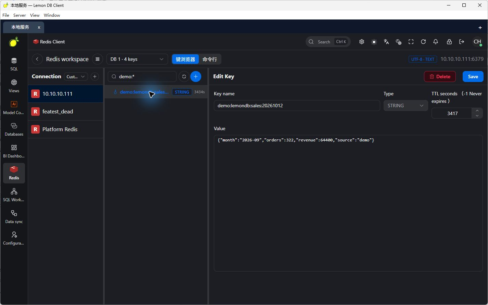
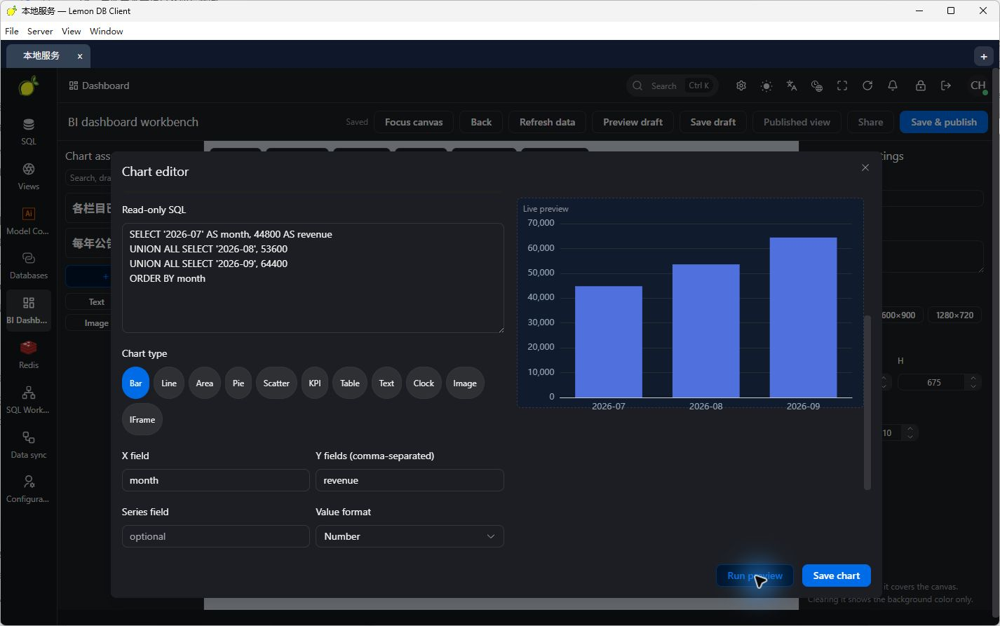
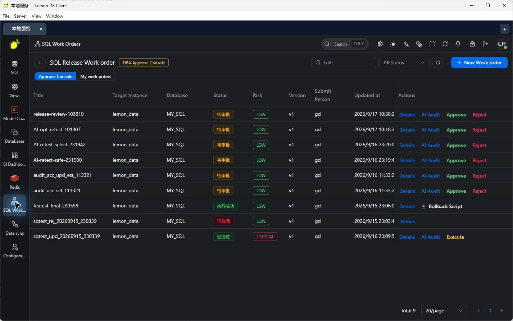

# LemonDB

**One client. Multiple servers. Connected at the same time.**

LemonDB is a database workbench for developers and DBAs. Its desktop client connects to multiple LemonDB servers in one window. Each server manages its own database connections, accounts, permissions, and tasks. SQL editing, an AI assistant, Redis, data pipelines, and BI dashboards share one workspace.

[简体中文](./README.zh-CN.md) · [Screenshot notes](./docs/SCREENSHOTS.md) · [Changelog](./CHANGELOG.md)

## Project status and validation scope

**LemonDB is under active development and available as a preview. Validation currently focuses on core workflows for MySQL-family databases. This does not mean that every MySQL-compatible product, version, or feature has been validated.**

Other database adapters and extended capabilities—including the AI assistant, AI schema documentation, visual queries and relation canvas, migration and backup, ETL, Redis, SQL work orders, and BI dashboards—are currently **experimental** and still being refined. Feature entries and demonstration screenshots show the current implementation; they do not establish production readiness or full compatibility. Before production use, validate your database version, permission configuration, and operational workflows.

## Intended use cases

LemonDB is designed for production environments where users cannot connect directly to databases from their computers, and for enterprises that need centrally managed database access permissions. Deploy the server where it can reach the target databases. Users connect through a browser or desktop client, and the server performs database operations. Enterprises can centrally manage connections, assign permissions at connection, database, and table levels, and use SQL work orders for submission, review, and execution.

## Demo and download

- Online demo: [http://test.ychos.cn:7777/](http://test.ychos.cn:7777/)
- Complete deployment package: [Download release.zip](./release.zip), containing the JAR, SQL initialization files, and a `bin` directory.

## Multiple servers in one window

Deploy separate LemonDB servers for development, testing, and production. Save their connection profiles and keep them open as tabs in the desktop client.

- **Stay connected:** switching server tabs keeps the other server connections open.
- **Separate sessions:** each server uses an independent browser session. Login state, database connections, SQL tabs, background tasks, and AI model selections are managed separately.
- **Connect quickly:** click `+` in the tab bar or press `Ctrl/Cmd + ,` to open the server selector. Enter a name and the full API base URL.
- **Local profiles:** save frequently used servers on your computer and test connectivity before opening the workbench.

There are two connection levels: one client can connect to multiple **LemonDB servers**, and each server can manage multiple **database connections**.

```text
LemonDB desktop client
├── Development server tab → Dev MySQL / PostgreSQL / Redis
├── Test server tab        → Test databases / Data pipelines
└── Production server tab  → Separate login / Permissions / SQL work orders
```

### Server selector

Save a name and API base URL for each environment. Include the server context path, for example `http://localhost:7806/lmdb`.



## Main capabilities

| Capability | What you can do |
| --- | --- |
| Database connections | Validation currently focuses on MySQL-family databases; adapters for PostgreSQL, Oracle, SQL Server, Dameng, H2, SQLite, MongoDB, and others are experimental |
| SQL workbench | Work with query tabs, autocomplete, formatting, result browsing and editing, and query history |
| Queries stored under databases | Save named queries for a connection and database, reopen them from the object tree, and import SQL files |
| AI assistant | Generate, explain, and optimize SQL using the current connection and schema; investigate errors and draft charts |
| AI schema documentation | Maintain business descriptions for tables and columns, with full or incremental generation and schema change detection |
| Visual queries and relation canvas | Organize queries visually and explore table relationships |
| Data migration and backup | Copy across connections, import/export SQL, use backup and native import tools, and track background task progress and results |
| Data pipelines (ETL) | Configure pipelines, field mappings, and previews, with scheduling and a Kettle import entry point |
| Redis console | Browse keys, types, and TTL; inspect or edit values and use CLI mode |
| SQL work orders and permissions | Submit, review, and execute SQL; manage access at connection, database, and table levels |
| BI dashboards | Bind SQL queries to chart components and publish data views |

This overview lists capabilities currently implemented or being refined; validation is limited to the scope described under “Project status and validation scope.” Available operations depend on the database dialect, server drivers, and account permissions. Compatibility adapters for OceanBase, PolarDB, KingbaseES, and GaussDB/openGauss also require validation for each specific product and version.

## Workbench gallery

The English UI screenshots below were captured from the desktop client on 2026-10-12. Queries and charts use demonstration data. See [screenshot notes](./docs/SCREENSHOTS.md) for matching Chinese images and localization notes.

### SQL editor and results

Browse database objects, write queries, and inspect results in one workspace. Database connection tabs and query tabs organize work across data sources.


### Queries belong to their database

Press `Ctrl+S` to name a query and save it for the current connection and database. Reopen it from that database’s query node to continue your work.



### Schema-aware AI assistance

Ask questions in the context of the active database. Schema documentation gives the assistant table, column, and relationship context for SQL and data analysis.





### Data pipelines and query previews

Organize queries, result writes, and field mappings as a pipeline. Use a read-only preview to inspect the query result before running a synchronization task.



### Redis and BI dashboards

Inspect Redis keys and visualize SQL data within the same workbench. The chart editor lets you select a chart type, map query fields, and preview a chart directly from SQL.





### SQL work orders

Submit SQL that requires review and manage the submission, approval, and execution workflow.



## Getting started

### Desktop client

1. Install the Lemon DB Client release package for your operating system.
2. Enter a server name and API base URL, such as `http://localhost:7806/lmdb`.
3. Test the connection, save and connect, then sign in with an account on that server.
4. Click `+` to connect another server and switch between server tabs.

The Electron desktop application has packaging configurations for Windows, macOS, and Linux. Check the release assets for the installers actually provided. You can also access a deployed Web workbench from a browser.

### Server: start the JAR

The frontend is bundled inside the JAR, so no separate frontend deployment is required. Download and extract the deployment package, initialize the metadata database using the included SQL files, configure your environment, and start the JAR:

```bash
java -jar lemon-main.jar --spring.profiles.active=pro
```

After deployment, open [http://127.0.0.1:7806/lmdb/view/index.html](http://127.0.0.1:7806/lmdb/view/index.html) in a browser. For access from another computer, replace `127.0.0.1` with the deployment server's address. The desktop client's API base URL is `http://127.0.0.1:7806/lmdb`.

The current backend uses Java 8, Spring Boot, MySQL, and Redis. To build from source, configure the environment metadata datasource and Redis in the complete backend source tree. From the backend project root:

```bash
mvn clean package -DskipTests
java -jar lemon-main/target/lemon-main.jar --spring.profiles.active=pro
```

Configure the environment’s metadata datasource and Redis before starting. The default API base URL is `http://localhost:7806/lmdb`. Database operations run on the server, which must be able to reach the target databases.

## Architecture

```text
Desktop client (Electron / Vue) or Web workbench
    ↓ API requests
LemonDB server (Spring Boot)
    ├── Database connections / SQL / Saved queries
    ├── AI assistant / Schema documentation
    ├── Redis / ETL / BI dashboards
    ├── Permissions / SQL work orders / Background tasks
    └── Database drivers and dialects → Target databases
```

**Author: yanch**

Refer to the LICENSE file in the published repository for licensing terms. This presentation directory does not currently contain a LICENSE file.
