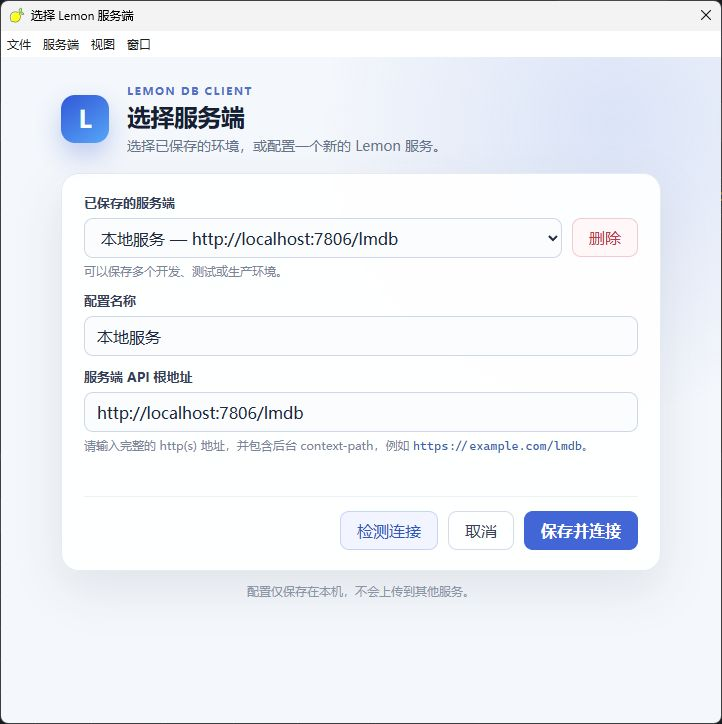
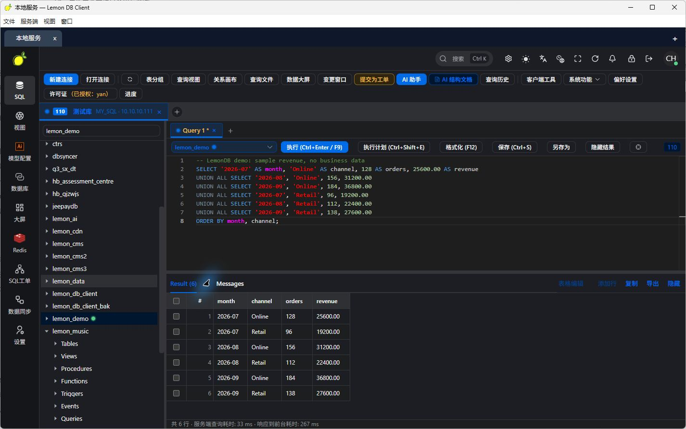
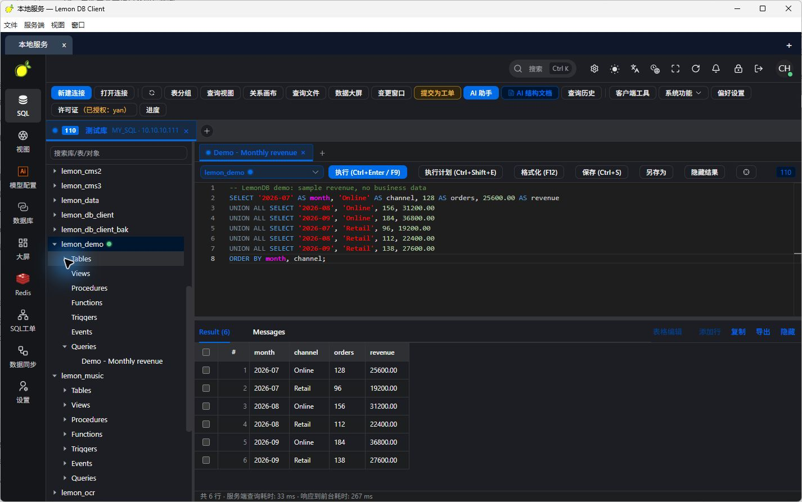
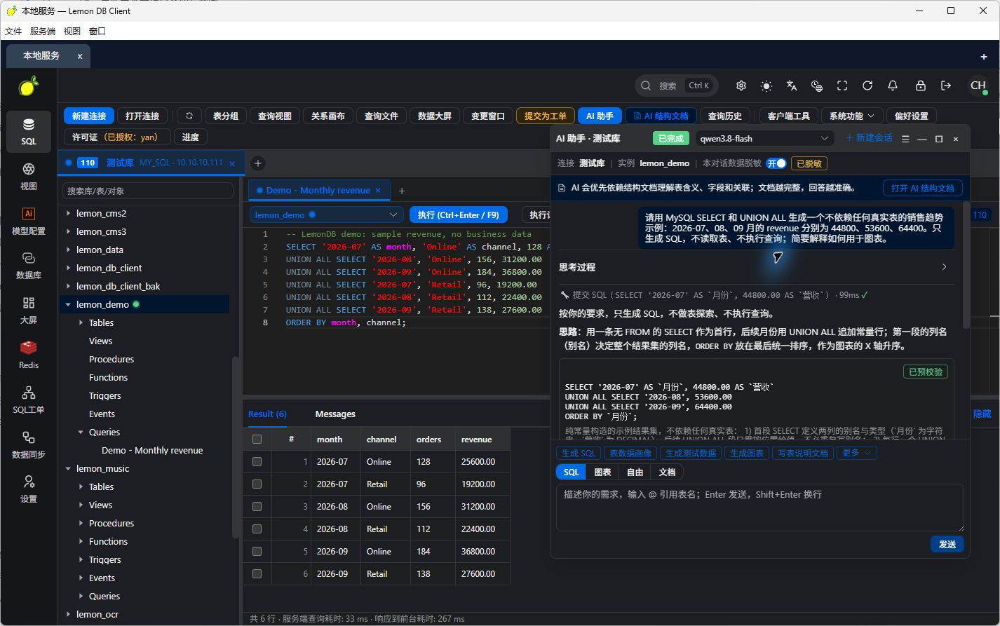
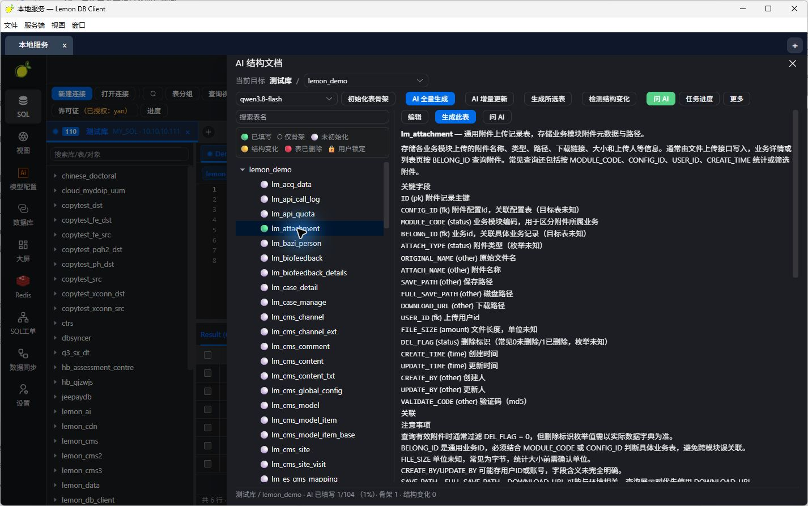
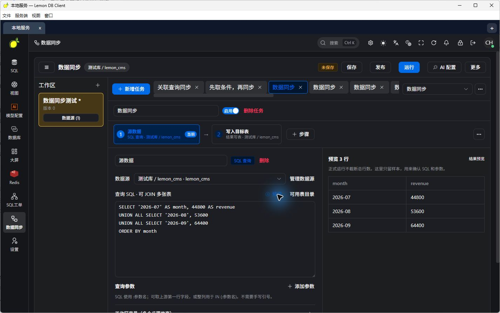
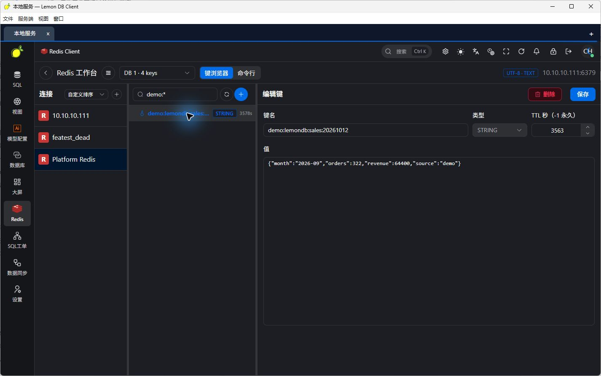
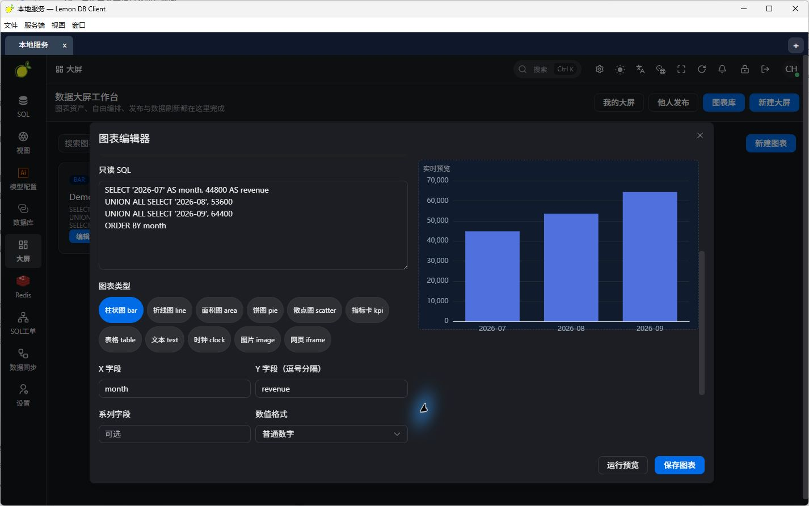
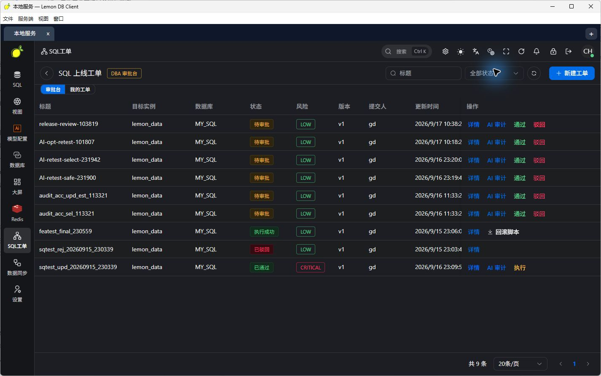

# LemonDB · 柠檬数据库客户端

**一个客户端，同时连接多个服务端。**

LemonDB 是面向开发者与 DBA 的数据库工作台。桌面客户端在同一窗口中连接多个 LemonDB 服务端，每个服务端管理自己的数据库连接、账号权限与任务。SQL 编辑、AI 助手、Redis、数据同步和数据大屏集中在一个工作台中。

[English](./README.md) · [截图说明](./docs/SCREENSHOTS.md) · [更新记录](./CHANGELOG.md)

## 项目状态与验证范围

**项目目前处于开发与预览阶段，尚未完成全面验证。当前着重验证 MySQL 族数据库的核心使用流程；这不代表所有 MySQL 兼容产品、版本和功能均已验证。**

其他数据库适配，以及 AI 助手、AI 结构文档、可视化查询与关系画布、数据迁移与备份、ETL、Redis、SQL 工单和数据大屏等扩展功能，目前作为**实验功能**提供，仍在完善中。功能入口和演示截图展示当前实现，不代表已经达到生产可用或完整兼容的状态。用于生产环境前，请针对实际数据库版本、权限配置和操作流程进行验证。

## 适用场景

LemonDB 面向生产环境无法从个人电脑直连数据库，以及企业内部需要统一管理数据库访问权限的场景。将服务端部署在能够访问目标数据库的环境中，用户通过浏览器或桌面客户端连接服务端，由服务端执行数据库操作。企业可集中管理数据库连接，按连接、库和表分配权限，并通过 SQL 工单组织提交、审核与执行。

## 演示与下载

- 在线演示：[http://test.ychos.cn:7777/](http://test.ychos.cn:7777/)
- 完整部署包：[下载 release.zip](./release.zip)，包含 JAR 包、SQL 初始化文件和 `bin` 目录。

## 特色：多个服务端，一个工作窗口

开发、测试与生产环境可以分别部署 LemonDB 服务端，客户端保存多个环境配置，通过顶部标签同时打开并切换。

- **同时在线**：切换服务端标签不会断开其他服务端。
- **独立会话**：每个服务端使用独立浏览器会话，登录状态、数据库连接、SQL 标签、后台任务和 AI 模型选择分别管理。
- **快速接入**：点击顶部 `+`，或使用 `Ctrl/Cmd + ,` 打开服务端选择器，填写名称和完整 API 根地址。
- **配置保存在本机**：保存常用服务端，检测连接后进入对应工作台。

“服务端连接”与“数据库连接”是两层能力：一个客户端可连接多个 LemonDB 服务端，每个服务端可管理多个数据库连接。

```text
LemonDB 桌面客户端
├── 开发服务端标签 → 开发 MySQL / PostgreSQL / Redis
├── 测试服务端标签 → 测试数据库 / 数据同步任务
└── 生产服务端标签 → 独立登录 / 权限 / SQL 工单
```

### 服务端选择器

为每个环境保存名称和服务地址。地址包含服务端 context-path，例如 `http://localhost:7806/lmdb`。



## 主要功能

| 功能 | 能做什么 |
| --- | --- |
| 数据库连接 | 当前着重验证 MySQL 族数据库；PostgreSQL、Oracle、SQL Server、达梦、H2、SQLite、MongoDB 等适配为实验功能 |
| SQL 工作台 | 多查询标签、语法补全、格式化、查询结果查看与编辑、查询历史 |
| 库下保存 SQL | 按连接和数据库保存命名查询，在对象树中重新打开；支持导入 SQL 文件 |
| AI 助手 | 结合当前连接与库结构生成、解释、优化 SQL，分析报错并辅助生成图表 |
| AI 结构文档 | 维护表和字段的业务说明，支持全量、增量生成与结构变更检测 |
| 可视化查询与关系画布 | 使用画布组织查询，查看表之间的关系 |
| 数据迁移与备份 | 跨连接复制、SQL 导入导出、备份与原生客户端导入，后台任务展示进度与执行结果 |
| 数据同步（ETL） | 配置流水线、字段映射与结果预览，支持定时任务和 Kettle 导入入口 |
| Redis 控制台 | 浏览键、类型和 TTL，查看或编辑数据，使用命令行模式 |
| SQL 工单与授权 | 提交、审核、执行 SQL；按连接、库和表管理访问权限 |
| 数据大屏 | 将 SQL 查询绑定到图表组件，组织并发布数据展示页面 |

以上为当前已实现或正在完善的功能，验证范围以本页“项目状态与验证范围”为准。具体数据库功能取决于数据库方言、服务端驱动与账号权限；OceanBase、PolarDB、KingbaseES、GaussDB/openGauss 等兼容适配同样需按具体产品和版本验证。

## 工作台展示

以下为 2026-10-12 从桌面客户端重新拍摄的中文界面，查询与图表使用示例数据。英文对应截图见[截图说明](./docs/SCREENSHOTS.md)。

### SQL 编辑与结果查看

在一个工作台浏览数据库对象、编写查询并查看结果。数据库连接标签和查询标签分别组织，方便在多个数据源之间工作。



### SQL 保存到所属数据库

使用 `Ctrl+S` 为查询命名，脚本归属于当前连接和数据库。下次从该数据库的查询节点打开，继续处理同一业务。



### 理解当前库的 AI 助手

在当前数据库上下文中提问，结合结构文档理解表、字段和关联，辅助完成 SQL 和数据分析工作。





### 数据同步与查询预览

把查询、结果写表和字段映射组织成流水线。在运行同步任务前，先用只读预览检查查询结果。



### Redis 与数据大屏

Redis 键浏览和 SQL 数据可视化集中在同一套工作台中。图表编辑器可选择图表类型、映射查询字段，并直接预览 SQL 生成的图表。





### SQL 工单

将需要审核的 SQL 提交为工单，组织提交、审核和执行流程。



## 开始使用

### 桌面客户端

1. 安装与你的操作系统对应的 Lemon DB Client 发布包。
2. 打开客户端，输入服务端名称和 API 根地址，例如 `http://localhost:7806/lmdb`。
3. 检测连接，保存并连接，然后使用该服务端的账号登录。
4. 点击顶部 `+` 接入其他服务端，在标签之间切换。

桌面端基于 Electron；Windows、macOS 和 Linux 均有打包配置，实际安装包以发布版本提供的文件为准。浏览器端也可访问已部署的 Web 工作台。

### 服务端：启动 JAR 即可使用

前端已打入 JAR 包，无需单独部署前端。下载并解压部署包，使用包内 SQL 文件完成初始化并配置对应环境后，启动 JAR 即可：

```bash
java -jar lemon-main.jar --spring.profiles.active=pro
```

部署成功后，浏览器访问 [http://127.0.0.1:7806/lmdb/view/index.html](http://127.0.0.1:7806/lmdb/view/index.html)。从其他电脑访问时，将 `127.0.0.1` 替换为部署服务器地址。桌面客户端填写的 API 根地址为 `http://127.0.0.1:7806/lmdb`。

当前后端使用 Java 8、Spring Boot、MySQL 和 Redis。如需从源码构建，在完整后端源码中配置对应环境的 MySQL 数据源与 Redis，然后在后端项目根目录构建并运行：

```bash
mvn clean package -DskipTests
java -jar lemon-main/target/lemon-main.jar --spring.profiles.active=pro
```

启动前配置对应环境的数据源与 Redis。服务端默认 API 根地址为 `http://localhost:7806/lmdb`；数据库访问由服务端执行，目标数据库须能被该服务端访问。

## 架构

```text
桌面客户端（Electron / Vue）或 Web 工作台
    ↓ API 请求
LemonDB 服务端（Spring Boot）
    ├── 数据库连接 / SQL / 查询保存
    ├── AI 助手 / 结构文档
    ├── Redis / ETL / 数据大屏
    ├── 权限 / SQL 工单 / 后台任务
    └── 数据库驱动与方言 → 目标数据库
```

**作者：yanch**

许可证以正式发布仓库的 LICENSE 文件为准；当前展示目录尚未包含 LICENSE 文件。
